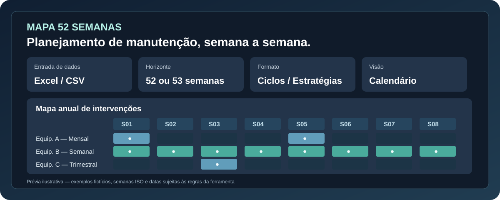

# Mapa 52 Semanas · Planejamento de Manutenção

**Ferramenta demonstrativa de planejamento anual por ciclos, datas programadas e estratégias de manutenção — com mapas semanais interativos.**  
Desenvolvido por **Talita Souza** · Engenharia de Controle e Automação · PCM, dados e automação

**[Abrir a demonstração online ↗](https://talita-olv.github.io/mapa-52-semanas/)** · **[Mapa por estratégias ↗](https://talita-olv.github.io/mapa-52-semanas/estrategias/)** · [Hub de ferramentas](https://talita-olv.github.io/mapa-52-semanas/hub/)

[](tests/) [](assets/engine.js) [](assets/SHEETJS-LICENSE.txt) [](LICENSE)



> **Atenção:** demonstração independente com **exemplos fictícios**. O mapa representa uma projeção ou a leitura das marcações da base informada — **não substitui programação oficial do CMMS, ordens de serviço, aprovações ou execução de campo**. O calendário pode ter 52 ou 53 semanas ISO.

## O problema

Visualizar milhares de intervenções em planilhas extensas dificulta conferir ciclos, identificar concentrações de demanda e entender quais equipamentos serão atendidos em cada semana.

O Mapa 52 Semanas oferece duas entradas complementares: **projetar datas a partir de ciclos e âncoras** ou **visualizar datas/pacotes já estruturados em estratégias**, preservando as premissas de cada base.

## O que a demonstração permite

- Importar planilhas Excel (`.xlsx` ou `.xls`) e CSV, escolhendo a aba e a linha de cabeçalho.
- Conferir o mapeamento das colunas antes da geração e revisar inconsistências/duplicatas.
- Gerar ocorrências por periodicidade textual, ciclos, datas já programadas ou pacotes independentes de estratégias.
- Distinguir ciclos de **15 dias** de ciclos de **2 semanas (14 dias)**, sem converter meses em 30 dias.
- Interpretar a data-base como primeira/próxima ocorrência ou última execução, conforme seleção.
- Construir um calendário com **52 ou 53 semanas ISO**, com distribuição semanal e pesquisa por equipamento/atividade.
- Filtrar por local, criticidade e tipo de manutenção; visualizar HH estimadas quando preenchidas.
- Analisar concentração e capacidade semanal com base nos dados informados.
- Exportar ocorrências para CSV e usar a impressão do navegador para PDF.
- Abrir o **[mapa por estratégias](https://talita-olv.github.io/mapa-52-semanas/estrategias/)**, com visão dos planos, itens, ciclos, status de cruzamento e marcações S01–S52 existentes na planilha.

## Como utilizar

**Opção A — Tenho periodicidade, ciclo ou datas programadas**

1. Abra o [mapa por ciclos e datas](https://talita-olv.github.io/mapa-52-semanas/) e selecione **Explorar exemplo** ou importe o [modelo Excel](exemplos/Modelos_Mapa_52_Semanas.xlsx).
2. Escolha o tipo de entrada e o ano ISO do planejamento.
3. Confirme as colunas, a data de referência e o tratamento de periodicidades.
4. Confira pendências; se optar por geração parcial, autorize a exclusão das linhas inválidas.
5. Gere o mapa, filtre as semanas e exporte os resultados.

**Opção B — Já possuo S01 a S52 por estratégia**

1. Abra o [mapa por estratégias](https://talita-olv.github.io/mapa-52-semanas/estrategias/).
2. Importe uma base com a aba `MAPA_52_SEMANAS`. As abas `RESUMO_ESTRATEGIAS` e `LEIA_ME` complementam a análise.
3. Revise planos, equipamentos, ciclos e pendências de cruzamento. **As marcações são lidas da planilha, não recalculadas como execução real.**
4. Consulte as semanas e exporte os dados filtrados.

A documentação específica está em [Guia do mapa por estratégia](docs/MAPA_POR_ESTRATEGIA.md) e [Regras e formatos](docs/REGRAS.md).

## Tecnologias e organização

| Tecnologia / arquivo | Aplicação |
| --- | --- |
| HTML, CSS e JavaScript | Interface interativa, validações, calendário e filtros |
| `assets/engine.js` e `assets/app.js` | Cálculo de ciclos, datas, semanas, importação e exportação |
| `assets/strategy-engine.js` e `assets/strategy-app.js` | Leitura das estratégias e visualização semanal |
| SheetJS CE local | Leitura Excel, sem download de biblioteca em CDN |
| `exemplos/` | Modelos e bases fictícias |
| `tests/` | Testes automatizados de calendário e estratégias |
| GitHub Pages | Publicação pública, sem autenticação |

O mapa pode ser aberto como projeto estático. Para distribuir um HTML independente, execute `python3 scripts/build_standalone.py`; o Python serve apenas para **empacotar**, não para operar o mapa.

## Premissas e limites

- Semanas ISO começam na segunda-feira; dependendo do ano, existe semana 53 e sobreposição entre datas civis de anos adjacentes.
- A projeção preserva meses de calendário e suas variações de dias.
- Pacotes de estratégia são tratados de forma independente e cumulativa; a ferramenta não reproduz todas as regras avançadas de hierarquia/supressão/tolerância de CMMS.
- Ciclos condicionais, por produção ou por horímetro exigem previsão externa.
- HH da seleção e capacidade semanal não representam disponibilidade efetiva de pessoas, especialidades, feriados ou turnos.
- O mapa por ciclos limita a importação a 20 MB, 20.000 linhas por aba e 250.000 ocorrências; outras visualizações possuem suas próprias restrições documentadas.
- Duplicidades e inconsistências requerem revisão; **não se criam ordens, apontamentos ou execução confirmada**.

Leia os detalhes em [Regras](docs/REGRAS.md) e [Validação](docs/VALIDACAO.md).

## Testes

```bash
node --test tests/*.test.cjs
```

Os testes incluem datas inválidas, dias 29/31, anos bissextos, períodos ISO, ciclos, estratégias e regras de leitura dos pacotes. A verificação de identidade checa as interfaces principal, estratégias e hub. Uma execução bem-sucedida dos testes não substitui a revisão do resultado no navegador.

## Privacidade, licença e autoria

A importação ocorre **na memória do navegador**, sem upload da planilha para um backend próprio e sem salvamento automático. O provedor da hospedagem pode registrar acessos normais ao site. Não publique arquivos corporativos ou dados pessoais no repositório.

Código principal sob [licença MIT](LICENSE); a biblioteca SheetJS possui licença própria, preservada em [SHEETJS-LICENSE.txt](assets/SHEETJS-LICENSE.txt) e nos [avisos de terceiros](THIRD_PARTY_NOTICES.md). A titularidade e a licença deste projeto são independentes das regras de outros repositórios do portfólio.

---

**Identidade visual:** [marca Talita Souza](assets/talita-brand.svg) · [banner do Mapa 52 Semanas](assets/project-banner.svg) · [template de README](https://github.com/talita-olv/talita-olv/blob/main/README_TEMPLATE.md)

Desenvolvido por **[Talita Souza](https://github.com/talita-olv)** · [LinkedIn](https://www.linkedin.com/in/talita-souza-136590122/)
